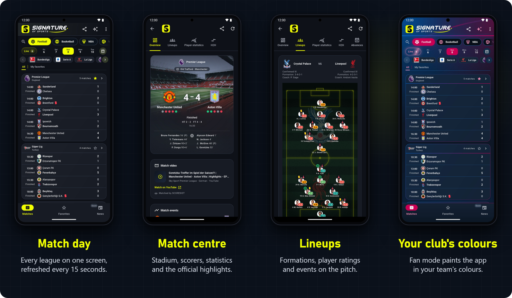

I build **[SCORESIST](https://www.scoresist.com)**, a live sports app for football, basketball (NBA included), volleyball and Formula 1. I run the product end to end: what we build, how it looks and how it holds up on match day.

## Where to find it

- **Web:** live at [www.scoresist.com](https://www.scoresist.com).
- **Android:** in testing on Google Play; public release coming soon.
- **iOS:** planned after Android.
- **Languages:** 29, including right-to-left Arabic and Hebrew.

## What it does

- **Live scores that keep up.** Every live match on one screen, refreshed every 15 seconds, with goals, cards and substitutions as they happen.
- **A full match centre.** Stadium photo, scorers, statistics, player ratings, head-to-head, absences and official highlight videos where available.
- **Lineups on the pitch.** Formations, player photos, ratings and match events in one view.
- **Standings with context.** Qualification zones, recent form, home and away tables, and live league positions next to each score.
- **Built for fans.** Google sign-in, favourites synced across devices, goal and lineup alerts on your phone, live match chat, fan ratings, share cards and themes in your club's colours.

## Under the hood

- **App:** Flutter, Riverpod and GoRouter for Android (iOS later).
- **Website:** SvelteKit on Cloudflare Workers, with pages search engines can read.
- **API:** NestJS and TypeScript on PostgreSQL with Prisma.
- **Data:** commercial sports data feeds, synced by background jobs that share a fixed request budget.
- **Accounts:** Supabase Auth with Google sign-in, and row-level security on every table.
- **Alerts:** Firebase Cloud Messaging for phone notifications.
- **Delivery:** GitHub Actions checks every change; the website ships to Cloudflare and the API to Railway.

Since August 2026: **700+ merged pull requests** and **4,000+ automated tests** running on every change.

## How I work

- **Product:** I decide what gets built and in what order, and define how every feature should behave.
- **Design:** I direct every screen, from layout and colour to match-day details, and approve the renders before release.
- **Testing:** I test each change on real matches and real phones, from live scores to push alerts.
- **Operations:** I run releases and the production side: hosting, database, sign-in, app-store accounts and costs.
- **Data quality:** I track data across leagues and decide how the app handles gaps and provider errors.

The code is written with AI coding assistants under my direction, and nothing ships without my sign-off.

The application source code is private. Club names, logos, photos and match data belong to their respective owners and data providers.
